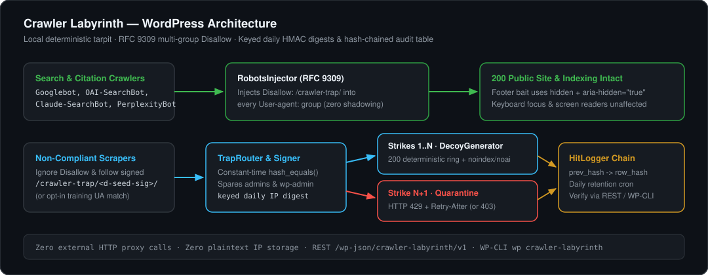
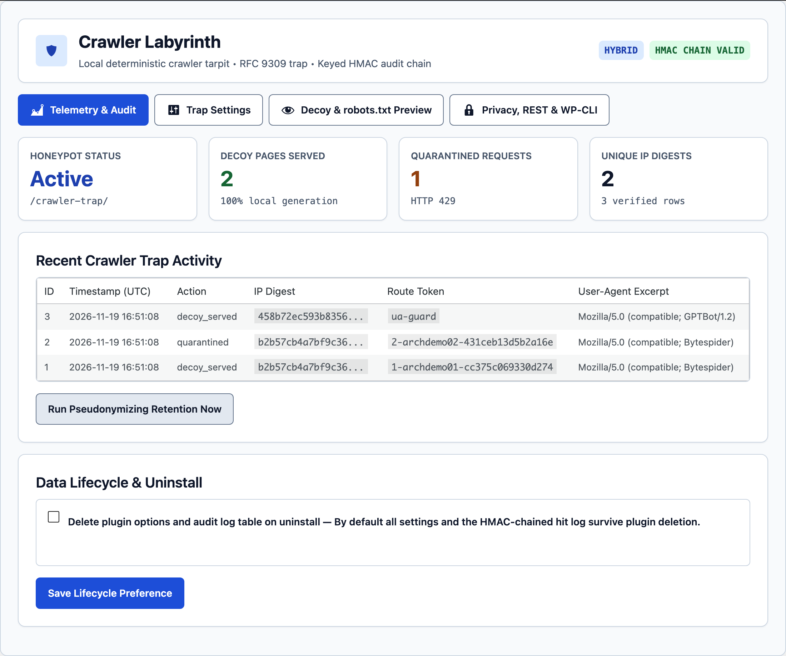
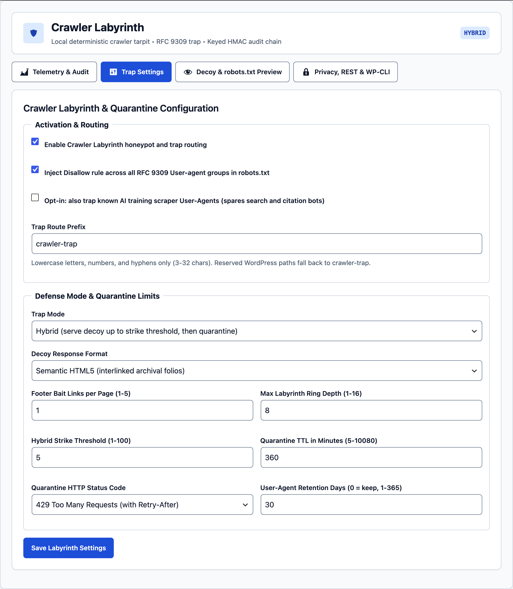
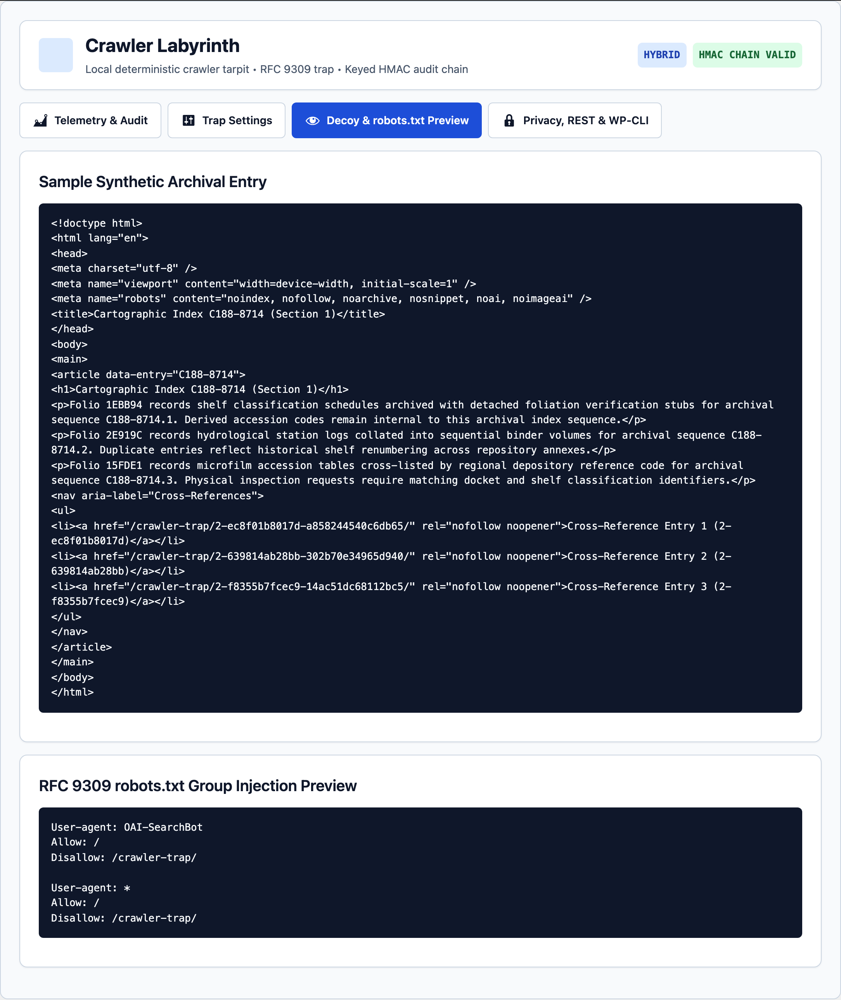

<p align="center">
  
</p>

<h1 align="center">Crawler Labyrinth</h1>

<p align="center">
  <strong>Local deterministic crawler tarpit and RFC 9309 <code>robots.txt</code> honeypot for WordPress, with hybrid HTTP 429/403 quarantine, HMAC-chained audit logging, and privacy-preserving daily IP digests.</strong>
</p>

<p align="center">
  <a href="https://github.com/arnoldwender/crawler-labyrinth/actions/workflows/ci.yml"></a>
  <a href="LICENSE"></a>
  
  
</p>

| Field | Value |
| --- | --- |
| **Author** | [Arnold Wender](https://arnoldwender.com) |
| **Repository** | [github.com/arnoldwender/crawler-labyrinth](https://github.com/arnoldwender/crawler-labyrinth) |
| **Companion Astro Package** | [arnoldwender/astro-crawler-labyrinth](https://github.com/arnoldwender/astro-crawler-labyrinth) |
| **Stack & Requirements** | WordPress 6.4+ · PHP 8.2+ · Pure PHP (no external proxy calls) |
| **License** | [GPLv2 or later](LICENSE) |
| **Support & Liability** | **Zero support** — reproducible bugs on [GitHub Issues](https://github.com/arnoldwender/crawler-labyrinth/issues) only · **no private support** · **AS IS / no liability** ([SUPPORT.md](SUPPORT.md)) |
| **Local Verification** | `php tests/test-suite.php && php tests/test-css-tokens.php && bash tests/run-mutations.sh` |

---

## Why Local & Deterministic Instead of an External Proxy?

Many crawler-tarpit snippets work by fetching and relaying third-party HTML from an external server on every crawler hit. In production WordPress hosting, relaying external pages carries real operational risks:

1. **Worker Exhaustion:** Holding PHP-FPM workers open on blocking outbound HTTP requests allows slow crawlers to saturate site capacity before they saturate their own.
2. **Untrusted Markup Exposure:** Relaying unverified external HTML creates XSS and supply-chain liability under your own origin.
3. **Zero Outbound Dependencies:** `DecoyGenerator` synthesizes bounded archival HTML5 or plain-text folios locally in sub-millisecond PHP execution using HMAC-SHA256 — zero outbound HTTP calls, zero CDN scripts, and zero third-party data transfers.

---

## Architecture Overview

<p align="center">
  
</p>

1. **RFC 9309 Multi-Group `robots.txt` Injection (`RobotsInjector`):** Injects `Disallow: /<prefix>/` into **every** `User-agent:` group (not only `User-agent: *`), preventing explicit `Allow: /` blocks for search or citation crawlers from shadowing the disallow rule.
2. **Accessible-Inert Footer Bait (`BaitRenderer`):** Prints `<div hidden aria-hidden="true" data-crawler-labyrinth="1">` with signed depth-1 links (`rel="nofollow noopener"`, `tabindex="-1"`, `aria-hidden="true"`) in `wp_footer` on unauthenticated public frontend responses only. Screen readers and keyboard tab order skip it automatically; logged-in users, feeds, previews, AJAX, and REST requests are excluded.
3. **Bounded Labyrinth & Hybrid Quarantine (`TrapRouter`):**
   - **`hybrid` (default):** Serves deterministic archival decoys (`200 OK` with `X-Robots-Tag: noindex, nofollow, noarchive, nosnippet, noai, noimageai`) up to `crawler_labyrinth_strike_threshold` hits (default `5`), then quarantines the client IP digest with HTTP `429 Too Many Requests` (including `Retry-After`) or `403 Forbidden` for `crawler_labyrinth_block_ttl_minutes`.
   - **`labyrinth`:** Continues serving ring-bounded archival decoys indefinitely without quarantining.
   - **`block`:** Immediately quarantines on the first disallowed hit.
4. **Search & Citation Crawler Protection:** Optional User-Agent enforcement (`crawler_labyrinth_intercept_training_ua`, disabled by default) explicitly exempts search, citation, and link-preview bots (`Googlebot`, `Bingbot`, `Applebot`, `OAI-SearchBot`, `ChatGPT-User`, `Claude-SearchBot`, `Claude-User`, `PerplexityBot`, `Perplexity-User`, `MistralAI-User`, `Slackbot`, `Storebot-Google`, `DuckDuckBot`) before evaluating training scraper tokens (`GPTBot`, `CCBot`, `ClaudeBot`, `anthropic-ai`, `Bytespider`, `PetalBot`, `Diffbot`, `Omgilibot`, `ImagesiftBot`, `DataForSeoBot`, `Scrapy`).
5. **Tamper-Evident Audit Chain & Pseudonymizing Retention (`HitLogger`):** Records hits in `{prefix}crawler_labyrinth_hits` using daily rotating keyed HMAC-SHA256 IP digests (raw IP addresses are never stored). Each row links to the previous `row_hash` (`prev_hash`). A daily WP-Cron job (`crawler_labyrinth_daily_purge`) redacts expired `user_agent_excerpt` values while writing a verifiable `retention_pseudonymized` residual hash record so chain integrity remains verifiable.
6. **Standalone Admin UI:** Ships a self-contained, token-based stylesheet (`assets/css/crawler-labyrinth-admin.css`) with zero external dependencies and a WordPress Dashboard telemetry widget.

---

## Installation

1. Copy or install the `crawler-labyrinth` directory into `wp-content/plugins/crawler-labyrinth/`.
2. Activate **Crawler Labyrinth** in **Plugins → Installed Plugins** or via WP-CLI:
   ```bash
   wp plugin activate crawler-labyrinth
   ```
3. Open **Crawler Labyrinth** in the WordPress Admin menu to inspect telemetry, test previews, or customize trap limits.

> **Page Cache & Reverse Proxy Note:** If you use Varnish, Nginx FastCGI cache, or a full-page cache plugin, exclude your trap prefix (default `/crawler-trap/*`) from caching so PHP can count per-client strikes and emit `429`/`403` quarantine headers dynamically. See [docs/DEVELOPER-GUIDE.md](docs/DEVELOPER-GUIDE.md) for examples.

---

## Screenshots

### Telemetry & Audit Dashboard

Live `Telemetry & Audit` view displaying `HONEYPOT STATUS` (`Active`, `/crawler-trap/`), `DECOY PAGES SERVED`, `QUARANTINED REQUESTS`, `UNIQUE IP DIGESTS`, the `HYBRID` and `HMAC CHAIN VALID` badges, `Recent Crawler Trap Activity`, retention controls, and `Data Lifecycle & Uninstall`.

<p align="center">
  
</p>

### Trap Settings

`Trap Settings` tab configuring `Activation & Routing` (including the opt-in AI training scraper toggle sparing search and citation bots, plus `Trap Route Prefix`) and `Defense Mode & Quarantine Limits`.

<p align="center">
  
</p>

### Decoy & `robots.txt` Preview

`Decoy & robots.txt Preview` tab inspecting a live `Sample Synthetic Archival Entry` (`Cartographic Index C188-8714 (Section 1)`) and the `RFC 9309 robots.txt Group Injection Preview`.

<p align="center">
  
</p>

---

## Configuration Options (`wp_options`)

| Option Name | Default | Allowed Range / Values | Purpose |
| --- | --- | --- | --- |
| `crawler_labyrinth_enabled` | `'1'` | `'1'` \| `'0'` | Global enable/pause switch |
| `crawler_labyrinth_route_prefix` | `'crawler-trap'` | `3-32` chars `[a-z0-9-]` | Trap URL path segment (reserved WP paths blocked) |
| `crawler_labyrinth_mode` | `'hybrid'` | `'hybrid'` \| `'labyrinth'` \| `'block'` | Decoy, block, or escalating strike mode |
| `crawler_labyrinth_response_format` | `'html'` | `'html'` \| `'plain'` | Archival HTML5 or plain-text response format |
| `crawler_labyrinth_link_count` | `1` | `1..5` | Hidden depth-1 bait links rendered in `wp_footer` |
| `crawler_labyrinth_max_depth` | `8` | `1..16` | Maximum traversal depth before wrapping back to depth `1` |
| `crawler_labyrinth_strike_threshold` | `5` | `1..100` | Decoy responses served before quarantine in `hybrid` mode |
| `crawler_labyrinth_block_ttl_minutes` | `360` | `5..10080` | Quarantine transient duration in minutes |
| `crawler_labyrinth_block_status` | `429` | `429` \| `403` | HTTP status code emitted while quarantined |
| `crawler_labyrinth_update_robots` | `'1'` | `'1'` \| `'0'` | Inject `Disallow: /<prefix>/` into `robots_txt` groups |
| `crawler_labyrinth_intercept_training_ua` | `'0'` | `'1'` \| `'0'` | Opt-in interception of training scraper User-Agents |
| `crawler_labyrinth_retention_days` | `30` | `0..365` | Days before `user_agent_excerpt` is redacted (`0` keeps) |
| `crawler_labyrinth_delete_data_on_uninstall` | `'0'` | `'1'` \| `'0'` | Opt-in removal of options, transients, and audit table on uninstall |
| `crawler_labyrinth_hmac_secret` | Auto-generated | 64-char hex | Persistent 256-bit key for tokens, digests, and hash chain |
| `crawler_labyrinth_schema_version` | `'1.0.0'` | SemVer string | Internal database schema version marker |

---

## WP-CLI & REST API

### WP-CLI (`wp crawler-labyrinth`)

```bash
wp crawler-labyrinth status
wp crawler-labyrinth preview --depth=2 --seed=archpreview1 --format=plain
wp crawler-labyrinth verify_chain
wp crawler-labyrinth purge_expired --dry-run
```

### REST API (`crawler-labyrinth/v1`)

All endpoints require an authenticated administrator (`current_user_can( 'manage_options' )`):

- `GET /wp-json/crawler-labyrinth/v1/status` — Normalized configuration and hit summary counters.
- `POST /wp-json/crawler-labyrinth/v1/preview` — Deterministic decoy preview (`depth`, `seed`, `format`).
- `POST /wp-json/crawler-labyrinth/v1/verify-chain` — Runs full HMAC chain verification (`200` if valid, `409` on mismatch).

---

## Hooks & Filters

| Hook | Type | Parameters | Purpose |
| --- | --- | --- | --- |
| `crawler_labyrinth_ready` | Action | `Plugin $instance` | Fires after plugin bootstrap completes |
| `crawler_labyrinth_trap_triggered` | Action | `string $action, string $token, int $strikes, string $ip_digest` | Fires when a decoy is served or a client enters quarantine |
| `crawler_labyrinth_bait_html` | Filter | `string $html, string $prefix, int $count` | Customize footer bait HTML prior to `wp_kses()` |
| `crawler_labyrinth_client_ip` | Filter | `string $raw_ip` | Resolve real client IP behind trusted reverse proxies |
| `crawler_labyrinth_allowed_bots` | Filter | `list<string> $tokens` | Extend search/citation crawler User-Agent exemptions |
| `crawler_labyrinth_training_bots` | Filter | `list<string> $tokens` | Extend training scraper User-Agent list for opt-in guard |
| `crawler_labyrinth_decoy_pools` | Filter | `array $pools` | Customize `collections`, `subjects`, `actions`, and `appendices` phrase pools |

Detailed developer documentation lives in [docs/ARCHITECTURE.md](docs/ARCHITECTURE.md) and [docs/DEVELOPER-GUIDE.md](docs/DEVELOPER-GUIDE.md).

---

## Development & Verification

```bash
php tests/test-suite.php
php tests/test-css-tokens.php
bash tests/run-mutations.sh
php tests/test-pot-freshness.php
python3 .github/scripts/security-audit.py
```

When testing inside an active WordPress installation:

```bash
wp eval-file wp-content/plugins/crawler-labyrinth/tests/test-runtime.php --allow-root --user=1
```

---

## Support, Bug Reports & Zero Liability

> **Zero Support & Use at Your Own Risk:** See [SUPPORT.md](SUPPORT.md).

- **Zero support:** This plugin is published as-is with **zero technical, setup, configuration, or user support**, and zero response SLA.
- **GitHub Issues only:** Reproducible software defects must be reported **exclusively** via [GitHub Issues](https://github.com/arnoldwender/crawler-labyrinth/issues) (or [GitHub Security Advisories](https://github.com/arnoldwender/crawler-labyrinth/security/advisories/new) for security vulnerabilities). Opening an issue carries no guarantee of a reply or fix.
- **No private support:** **Do not** send private support requests via email, `arnoldwender.com`, or direct messages. Private inquiries are never answered.
- **Zero responsibility & no warranty ("AS IS"):** Under Sections 11 and 12 of the [GNU General Public License v2 or later](LICENSE), this software is provided **"AS IS"** without warranty of any kind, and the author accepts **zero responsibility or liability** for any damages, downtime, data loss, false positives, caching/proxy misbehavior, or search/crawler indexing effects arising from its use.

---

## Contributing & Security

- **Support Policy:** See [SUPPORT.md](SUPPORT.md) — **zero support** and **no private support** under any circumstances.
- **Contributing:** See [CONTRIBUTING.md](CONTRIBUTING.md) and [CODE_OF_CONDUCT.md](CODE_OF_CONDUCT.md).
- **Security Policy:** See [SECURITY.md](SECURITY.md) — submit vulnerability reports **exclusively** via GitHub Private Vulnerability Reporting, never privately via email or public issues.

## License

Licensed under the [GNU General Public License v2 or later](LICENSE) (`GPL-2.0-or-later`).
