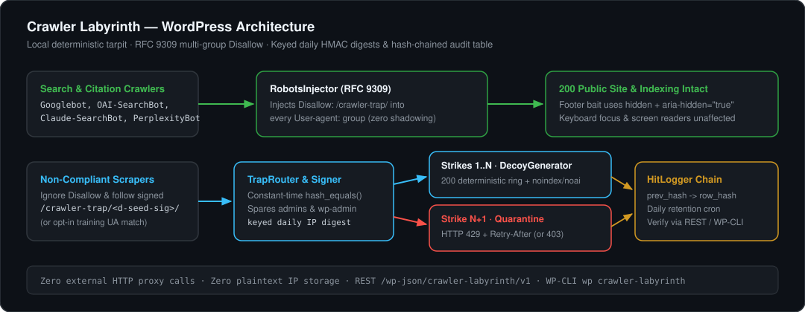

# Architecture — Crawler Labyrinth

`crawler-labyrinth` · Version `1.0.3` · WordPress 6.4+ · PHP 8.2+ · Text Domain `crawler-labyrinth`

<p align="center">
  
</p>

---

## 1. Runtime Request Flow

```
robots_txt (priority 999)
  └─ RobotsInjector::inject() adds Disallow: <base_path>/<prefix>/ to every User-agent group

wp_footer (priority 99, unauthenticated public HTML only)
  └─ BaitRenderer::render_footer_bait() emits <div hidden inert aria-hidden="true" data-crawler-labyrinth="1">

template_redirect (priority 1)
  └─ TrapRouter::handle_request()
       ├─ Exclusions: disabled | manage_options | non-matching subdir base | /wp-admin | /wp-login.php | /wp-json | /robots.txt | /.well-known | /sitemap | /feed
       ├─ Quarantine transient hit (crawler_labyrinth_q_<ip_digest24>, with multi-day UTC lookback) -> DONOTCACHEPAGE + HTTP 429 (+ Retry-After) or 403
       ├─ Route prefix match OR opt-in training UA match (sparing ALLOWED_SEARCH_UA_TOKENS)
       ├─ Increment strike transient (crawler_labyrinth_s_<ip_digest24>)
       ├─ mode == block OR (mode == hybrid && strikes > strike_threshold)
       │    └─ Persist quarantine transient, append advisory-locked 'quarantined' audit row, return 429/403
       └─ Else
            └─ TokenSigner::verify() (depth <= max_depth) -> DecoyGenerator::generate(), append advisory-locked 'decoy_served' row, return 200 OK (empty body on HEAD)
```

---

## 2. Token Format & Ring Topology

Signed trap links follow `<depth>-<seed>-<hmac16>`:

- `depth`: integer `1..16` (clamped by `crawler_labyrinth_max_depth`)
- `seed`: lowercase alphanumeric seed (`4..24` chars)
- `hmac16`: first 16 hex chars of `hash_hmac('sha256', "$depth|$seed", $secret)`

Verification uses `hash_equals()` in constant time. Once `depth` reaches `max_depth`, `DecoyGenerator` wraps generated child links back to `depth = 1` using HMAC-derived child seeds so traversal remains bounded and cache-predictable without blowing up server state.

---

## 3. RFC 9309 Multi-Group `robots.txt` Injection

Under RFC 9309, a crawler that matches an explicit group (such as `User-agent: OAI-SearchBot`) ignores the wildcard `User-agent: *` block. Placing `Disallow: /crawler-trap/` only under `*` leaves named groups free to crawl trap URLs if their group already has `Allow: /`. `RobotsInjector::inject()` inserts `Disallow: /<prefix>/` idempotently into **every** `User-agent:` stanza.

---

## 4. Database Schema & Hash Chain

Table: `{prefix}crawler_labyrinth_hits` (`InnoDB`)

| Column | Type | Purpose |
| --- | --- | --- |
| `id` | `BIGINT UNSIGNED AUTO_INCREMENT` | Sequential chain primary key |
| `created_at` | `DATETIME` | UTC timestamp (`Y-m-d H:i:s`) |
| `ip_digest` | `CHAR(64)` | Daily keyed HMAC-SHA256 digest (`$ip . '|' . $utc_day`) |
| `ua_digest` | `CHAR(64)` | Keyed HMAC-SHA256 digest of `User-Agent` |
| `user_agent_excerpt` | `VARCHAR(191)` | Sanitized excerpt or `[REDACTED]` after retention |
| `route_token` | `VARCHAR(128)` | Captured route token or `root` / `ua-guard` |
| `action_taken` | `VARCHAR(32)` | `decoy_served`, `quarantined`, or `retention_pseudonymized` |
| `meta_json` | `TEXT` | JSON metadata (stores `{"residuals": {...}}` for retention rows) |
| `prev_hash` | `CHAR(64)` | Previous row's `row_hash` (`000...` for row 1) |
| `row_hash` | `CHAR(64)` | `v1` HMAC-SHA256 signature across row columns + `prev_hash` |

### Pseudonymizing Retention Without Breaking Verification

Rather than deleting aged rows or silently breaking `prev_hash` links, `HitLogger::purge_expired()`:

1. Selects rows older than `crawler_labyrinth_retention_days` not yet redacted.
2. Verifies each row's `v1` `row_hash` and computes a `redacted-v1` residual hash omitting `user_agent_excerpt`.
3. Appends an advisory-locked `retention_pseudonymized` chain entry containing `{"residuals": {"<id>": "<residual_hex>"}}`, aborting cleanly if chain insertion fails.
4. Updates expired rows to `user_agent_excerpt = '[REDACTED]'` and purges expired transient rows across batches.

`HitLogger::verify_chain()` verifies records via bounded keyset pagination (`id > $last_id`) and fails if any row's `prev_hash` breaks, any active row fails `v1`, any redacted row lacks an authorized `retention_pseudonymized` anchor, or any non-excerpt column on a redacted row fails `redacted-v1`.

---

## 5. Security & Lifecycle Invariants

1. **Constant-Time Verification:** `TokenSigner::verify()` and `HitLogger::verify_chain()` use `hash_equals()`.
2. **Per-Form Admin Writes:** `AdminDashboard::save_settings()` switches explicitly on `crawler_labyrinth_form` (`settings` | `lifecycle` | `purge_now`) so submitting one form never resets unrelated options.
3. **Self-Contained Styles:** `assets/css/crawler-labyrinth-admin.css` defines all palette, spacing, and focus tokens locally under `--cl-*` with zero external requests.
4. **Opt-In Uninstall:** `uninstall.php` removes options, `_transient_crawler_labyrinth_%` keys, cron schedule, and `{prefix}crawler_labyrinth_hits` only when `crawler_labyrinth_delete_data_on_uninstall` is `'1'`.
